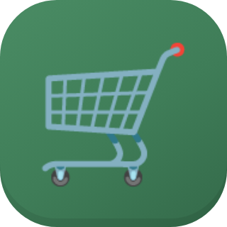
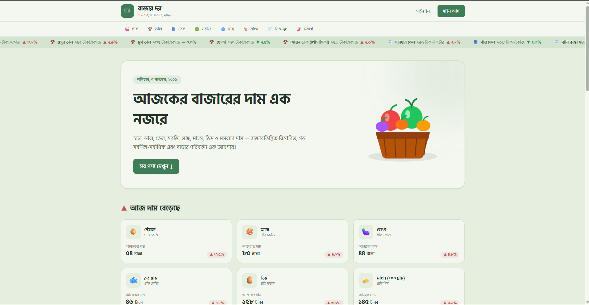
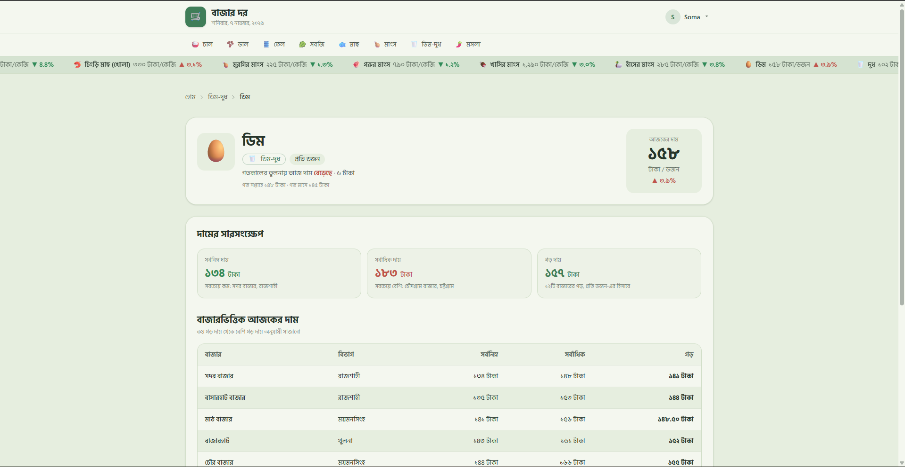
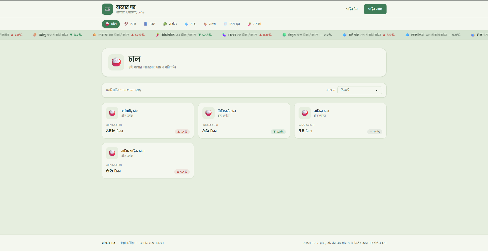
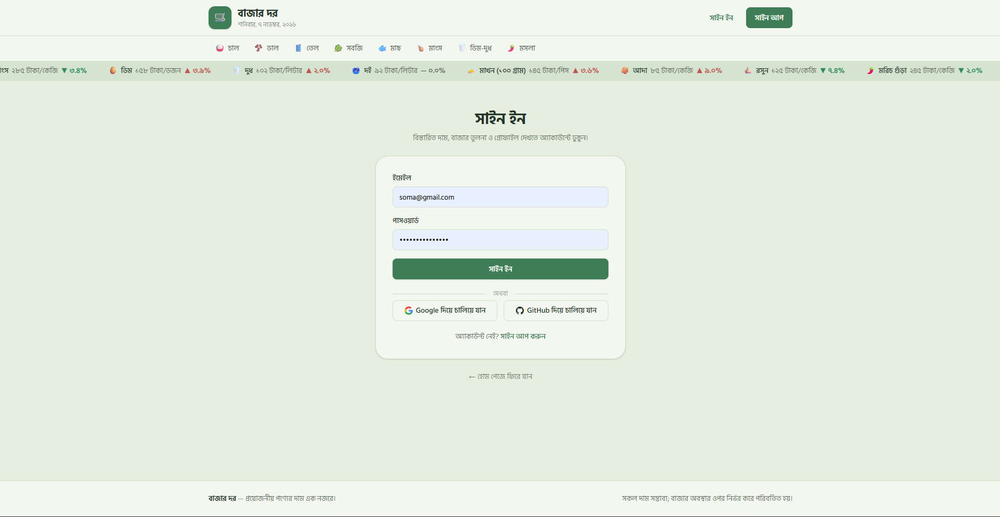
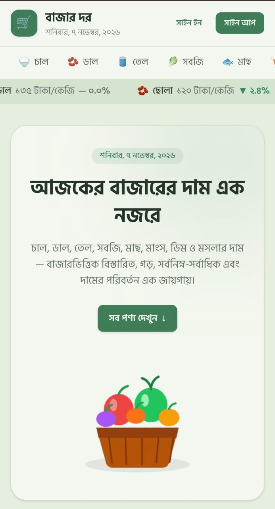
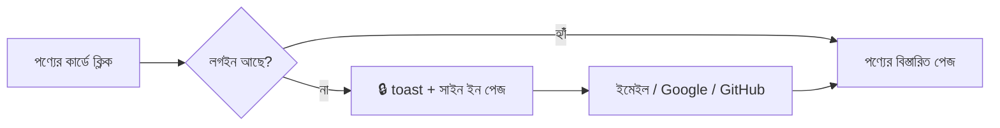

<div align="center">



# বাজার দর · BazarDor

### বাংলাদেশের নিত্যপ্রয়োজনীয় পণ্যের আজকের দাম — এক নজরে

চাল, ডাল, তেল, সবজি, মাছ, মাংস, ডিম-দুধ ও মসলার দাম, দাম বাড়া-কমার হিসাব<br/>
আর দেশের ১২টি বাজারের দামের তুলনা — সবকিছু এক জায়গায়, বাংলায়।

<br/>

[](https://bazar-dor-sb-b722.vercel.app)

<br/>


</div>

<br/>

<p align="center">
  
</p>

---

## 📖 পরিচিতি

**বাজার দর** একটি বাংলা ভাষার মূল্য-তথ্য ওয়েবসাইট। বাজারে যাওয়ার আগে একজন সাধারণ ক্রেতা যেন সহজেই জানতে পারেন — আজ কোন পণ্যের দাম কত, গতকালের তুলনায় বেড়েছে না কমেছে, আর কোন বাজারে সবচেয়ে কম দামে পাওয়া যাচ্ছে।

API থেকে ৮টি ক্যাটাগরির ৩৩টি পণ্যের তথ্য এনে সাইটটি দাম, শতকরা পরিবর্তন, বাজারভিত্তিক সর্বনিম্ন-সর্বাধিক ও গড় দাম দেখায়। সব সংখ্যা বাংলা অঙ্কে, সব লেখা বাংলায়। পণ্যের বিস্তারিত ও প্রোফাইল দেখতে ব্যবহারকারীকে সাইন ইন করতে হয় — ইমেইল, Google অথবা GitHub দিয়ে।

> 🔗 **লাইভ সাইট:** https://bazar-dor-sb-b722.vercel.app

---

## ✨ মূল ৫টি ফিচার

<table>
<tr>
<td width="50">

### 📈

</td>
<td>

**১. আজকের দাম ও দামের গতি এক নজরে**<br/>
Navbar-এর নিচে অনবরত চলতে থাকা দামের ticker। হোম পেজে আলাদা করে **"আজ দাম বেড়েছে ▲"** আর **"আজ দাম কমেছে ▼"** — সবচেয়ে বেশি পরিবর্তন হওয়া ৬টি করে পণ্য। দাম বাড়লে লাল, কমলে সবুজ, অপরিবর্তিত থাকলে ধূসর ব্যাজ।

</td>
</tr>
<tr>
<td>

### 🗂️

</td>
<td>

**২. ক্যাটাগরি অনুযায়ী পণ্য ও দাম অনুযায়ী সাজানো**<br/>
৮টি ক্যাটাগরির আলাদা পেজ (`/category/[slug]`), Navbar-এ বর্তমান ক্যাটাগরি হাইলাইট। **ডিফল্ট / দাম: কম থেকে বেশি / দাম: বেশি থেকে কম** — বাংলা অঙ্কের দামও সংখ্যা হিসেবে সঠিকভাবে সাজানো হয় (লেখা হিসেবে নয়)।

</td>
</tr>
<tr>
<td>

### 🏪

</td>
<td>

**৩. বাজারভিত্তিক বিস্তারিত দাম**<br/>
প্রতিটি পণ্যের নিজস্ব পেজে (`/product/[slug]`) সর্বনিম্ন, সর্বাধিক ও গড় দাম — কোন বাজারে সবচেয়ে সস্তা আর কোথায় সবচেয়ে দামি সেটাও। ঢাকা থেকে সিলেট পর্যন্ত ১২টি বাজারের দামের টেবিল, কম গড় দাম থেকে বেশি গড় দামের ক্রমে।

</td>
</tr>
<tr>
<td>

### 🔐

</td>
<td>

**৪. নিরাপদ লগইন ও সুরক্ষিত পেজ**<br/>
**BetterAuth** দিয়ে ইমেইল-পাসওয়ার্ড, **Google** ও **GitHub** লগইন; তথ্য থাকে **MongoDB**-তে। লগইন ছাড়া পণ্যের বিস্তারিত বা প্রোফাইলে গেলে 🔒 toast দেখিয়ে সাইন ইন পেজে পাঠানো হয়, আর লগইনের পর ঠিক সেই পেজেই ফিরিয়ে আনা হয়।

</td>
</tr>
<tr>
<td>

### 👤

</td>
<td>

**৫. আমার প্রোফাইল ও তথ্য আপডেট**<br/>
প্রোফাইল পেজে নাম, ইমেইল, ছবি ও অ্যাকাউন্ট খোলার তারিখ। আলাদা রুট `/my-profile/update` থেকে নাম বদলানো যায় — বদলানোর সাথে সাথে Navbar-এও নতুন নাম দেখায়।

</td>
</tr>
</table>

**আরও যা আছে:** স্কেলিটন লোডিং · প্রতিটি কাজে বাংলা toast নোটিফিকেশন · নিজস্ব 404 পেজ · মোবাইল, ট্যাবলেট ও ডেস্কটপে রেসপন্সিভ · বাংলা তারিখ ও বাংলা অঙ্ক · নরম সবুজ রঙের কাস্টম daisyUI থিম

---

## 🛠️ ব্যবহৃত প্রযুক্তি

| প্রযুক্তি | কী কাজে ব্যবহার হয়েছে |
|---|---|
| **Next.js 16** (App Router) | পেজ, ডাইনামিক রুট (`[slug]`), Server Components, `loading.js` ও `not-found.js` |
| **React 19** | কম্পোনেন্ট, `useState`, `useEffect`, Suspense |
| **Tailwind CSS 4** | পুরো সাইটের স্টাইল ও রেসপন্সিভ লেআউট |
| **daisyUI 5** | কাস্টম `bazardor` থিম, `btn`, `card`, `badge`, `skeleton`, `table`, `select`, `dropdown` |
| **BetterAuth** | ইমেইল-পাসওয়ার্ড, Google ও GitHub লগইন, session, প্রোফাইল আপডেট (`updateUser`) |
| **MongoDB Atlas** | ব্যবহারকারী, session ও অ্যাকাউন্টের তথ্য সংরক্ষণ (`@better-auth/mongo-adapter`) |
| **react-hot-toast** | সাইন ইন, সাইন আপ, সাইন আউট, ভুল তথ্য ও সুরক্ষিত পেজের নোটিফিকেশন |
| **Intl API** (`bn-BD`) | বাংলা অঙ্ক (১,৮৫০), বাংলা তারিখ (শনিবার, ৭ নভেম্বর, ২০২৬) |
| **Hind Siliguri** (Google Fonts) | বাংলা লেখার ফন্ট |
| **Vercel** | ডিপ্লয়মেন্ট |

---

## 📸 স্ক্রিনশট

<table>
<tr>
<td width="50%" align="center"><b>পণ্যের বিস্তারিত</b></td>
<td width="50%" align="center"><b>ক্যাটাগরি ও সাজানো</b></td>
</tr>
<tr>
<td></td>
<td></td>
</tr>
<tr>
<td align="center"><b>সাইন ইন</b></td>
<td align="center"><b>মোবাইল ভিউ</b></td>
</tr>
<tr>
<td></td>
<td align="center"></td>
</tr>
</table>

---

## 🗺️ পেজ ও রুট

| রুট | পেজ | লগইন লাগবে? |
|---|---|:---:|
| `/` | হোম — হিরো, দাম বেড়েছে, দাম কমেছে, সব পণ্য | — |
| `/category/[slug]` | ক্যাটাগরির পণ্য ও সাজানো | — |
| `/product/[slug]` | পণ্যের বিস্তারিত ও বাজারভিত্তিক দাম | 🔒 |
| `/signin` · `/signup` | সাইন ইন ও সাইন আপ | — |
| `/my-profile` | আমার প্রোফাইল | 🔒 |
| `/my-profile/update` | তথ্য আপডেট | 🔒 |
| `/privacy` | গোপনীয়তা নীতি | — |



---

## 🚀 নিজের কম্পিউটারে চালাতে

**১. রিপোজিটরি ক্লোন ও প্যাকেজ ইনস্টল**

```bash
git clone <এই-রিপোজিটরির-লিংক>
cd bazar-dor
npm install
```

**২. প্রজেক্টের মূল ফোল্ডারে `.env.local` ফাইল তৈরি করুন**

```env
MONGODB_URI=your_mongodb_atlas_connection_string
BETTER_AUTH_SECRET=your_random_secret
BETTER_AUTH_URL=http://localhost:3000

GOOGLE_CLIENT_ID=your_google_client_id
GOOGLE_CLIENT_SECRET=your_google_client_secret

GITHUB_CLIENT_ID=your_github_client_id
GITHUB_CLIENT_SECRET=your_github_client_secret
```

> Google ও GitHub-এর OAuth অ্যাপে callback URL দিন: `http://localhost:3000/api/auth/callback/google` এবং `http://localhost:3000/api/auth/callback/github`

**৩. চালু করুন**

```bash
npm run dev
```

ব্রাউজারে খুলুন: http://localhost:3000

<details>
<summary><b>📁 ফোল্ডার কাঠামো দেখুন</b></summary>

<br/>

```
bazar-dor/
├── app/
│   ├── api/auth/[...all]/route.js   # BetterAuth API
│   ├── category/[slug]/             # ক্যাটাগরি পেজ + loading
│   ├── product/[slug]/              # পণ্যের বিস্তারিত (সুরক্ষিত) + loading
│   ├── my-profile/                  # প্রোফাইল + update রুট
│   ├── signin/ · signup/            # লগইন ও রেজিস্ট্রেশন
│   ├── privacy/                     # গোপনীয়তা নীতি
│   ├── layout.js · page.js          # মূল লেআউট ও হোম পেজ
│   ├── not-found.js                 # 404 পেজ
│   └── globals.css                  # Tailwind + daisyUI কাস্টম থিম
├── components/
│   ├── navbar/                      # লোগো, তারিখ, ক্যাটাগরি, ticker, auth বাটন
│   ├── Home/                        # হিরো ও পণ্যের সেকশন
│   ├── product/                     # পণ্যের কার্ড, skeleton, বিস্তারিত অংশ
│   ├── category/                    # ক্যাটাগরি হেডার ও sort
│   ├── auth/                        # সাইন ইন/আপ ফর্ম, সোশ্যাল লগইন
│   └── profile/                     # প্রোফাইল ও আপডেট ফর্ম
├── lib/
│   ├── api.js                       # API থেকে ডেটা আনা (বিকল্প URL সহ)
│   ├── auth.js · auth-client.js     # BetterAuth (server ও browser)
│   ├── format.js                    # বাংলা অঙ্ক, একক, টাকা
│   └── products.js                  # sort, বেড়েছে/কমেছে, বাজারের হিসাব
└── public/                          # লোগো ও হিরো ছবি
```

</details>

---

## 🔌 ডেটা উৎস

পণ্য ও ক্যাটাগরির তথ্য আসে Programming Hero-র Bazar Dor API থেকে:

| Endpoint | কাজ |
|---|---|
| `GET /api/bazardor/categories` | সব ক্যাটাগরি |
| `GET /api/bazardor/products` | সব পণ্য |
| `GET /api/bazardor/products?category={slug}` | একটি ক্যাটাগরির পণ্য |

মূল API কাজ না করলে সাইটটি নিজে থেকেই বিকল্প URL থেকে ডেটা আনার চেষ্টা করে।

---

<div align="center">

**বাজার দর** — প্রয়োজনীয় পণ্যের দাম এক নজরে।

<sub>সকল দাম সম্ভাব্য; বাজার অবস্থার ওপর নির্ভর করে পরিবর্তিত হয়।</sub>

</div>
